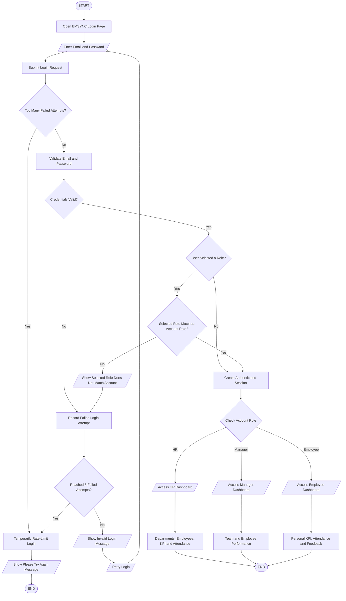
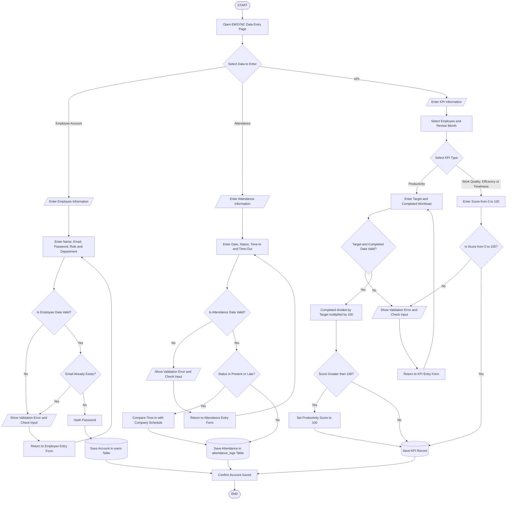
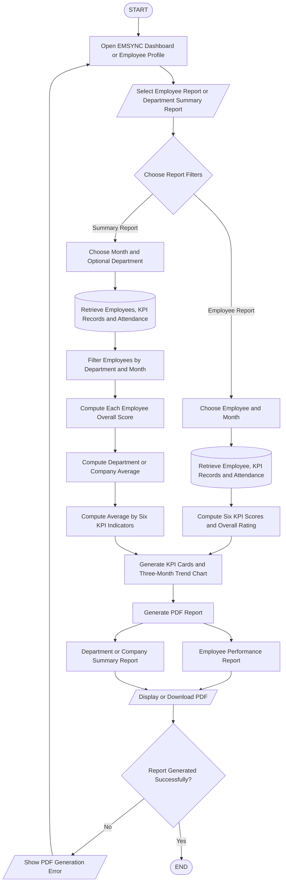
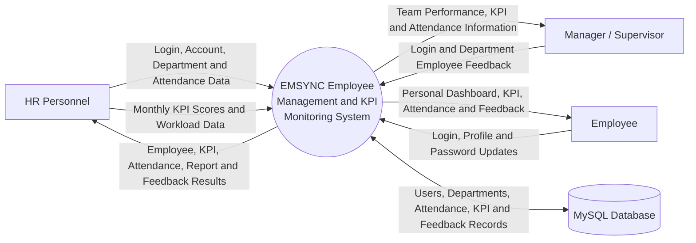
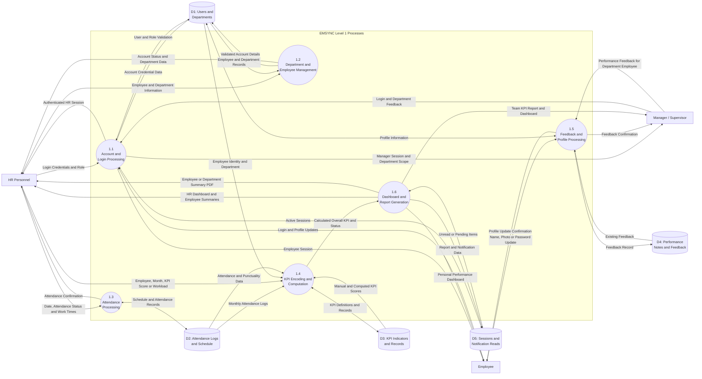

# EMSYNC Draw.io Flowchart

Paste this Mermaid code into Draw.io using the Mermaid import option.

```mermaid
flowchart TD
    Start([Start]) --> Login[User Opens EMSYNC Login]
    Login --> EnterCredentials[Enter Email and Password]
    EnterCredentials --> Authenticate{Credentials Valid?}

    Authenticate -->|No| LoginError[Display Login Error]
    LoginError --> EnterCredentials

    Authenticate -->|Yes| DetermineRole{Check User Role}

    DetermineRole -->|Employee| EmployeeDashboard[Open Employee Dashboard]
    DetermineRole -->|Manager| ManagerDashboard[Open Manager Dashboard]
    DetermineRole -->|HR| HRDashboard[Open HR Dashboard]

    EmployeeDashboard --> ViewEmployeeData[View Personal Scores, Attendance and Feedback]
    ViewEmployeeData --> EndEmployee([End])

    ManagerDashboard --> ViewTeam[View Employees in Assigned Department]
    ViewTeam --> SelectEmployee[Select an Employee]
    SelectEmployee --> ViewTeamPerformance[View Employee KPI and Attendance]
    ViewTeamPerformance --> AddFeedback{Add Performance Feedback?}
    AddFeedback -->|Yes| SaveFeedback[Save Feedback to Database]
    SaveFeedback --> ViewTeamPerformance
    AddFeedback -->|No| EndManager([End])

    HRDashboard --> HRAction{Choose HR Action}

    HRAction -->|Manage Accounts| ManageAccounts[Open Employees Page]
    ManageAccounts --> AccountAction{Choose Account Action}
    AccountAction -->|Create Account| EnterAccount[Enter Name, Email, Password, Role and Department]
    EnterAccount --> ValidateAccount{Account Data Valid and Email Unique?}
    ValidateAccount -->|No| EnterAccount
    ValidateAccount -->|Yes| HashPassword[Hash Password]
    HashPassword --> SaveAccount[(Save User in users Table)]
    SaveAccount --> HRAction

    AccountAction -->|Edit or Archive Account| UpdateAccount[Update Account or Move to Archived Accounts]
    UpdateAccount --> SaveAccount

    HRAction -->|Manage Attendance| AttendancePage[Open Attendance Bulk Page]
    AttendancePage --> SetSchedule[Set Company Time-In and Time-Out Schedule]
    SetSchedule --> SelectDate[Choose Date and Department]
    SelectDate --> EnterAttendance[Enter Present, Late, Absent or Excused]
    EnterAttendance --> SaveAttendance{Time-In Is Present or Late?}
    SaveAttendance -->|Yes| CompareTime[Compare Time-In with Schedule]
    CompareTime --> SetAttendanceStatus[Set Status to Present or Late]
    SetAttendanceStatus --> SaveAttendanceRecord[(Save Attendance Log)]
    SaveAttendance -->|No| SaveAttendanceRecord
    SaveAttendanceRecord --> ComputeAttendance[Calculate Monthly Attendance and Punctuality]

    HRAction -->|Manage KPI| KPIPage[Open KPI Management]
    KPIPage --> SelectPeriod[Select Employee or Bulk Employee Group]
    SelectPeriod --> SelectMonth[Select Review Month]
    SelectMonth --> KPIType{Select KPI Type}

    KPIType -->|Productivity| EnterWorkload[Enter Target Workload and Completed Workload]
    EnterWorkload --> ComputeProductivity[Completed divided by Target multiplied by 100]
    ComputeProductivity --> CapProductivity{Result Greater than 100?}
    CapProductivity -->|Yes| Set100[Set Productivity Score to 100]
    Set100 --> SaveKPI
    CapProductivity -->|No| SaveKPI

    KPIType -->|Work Quality, Efficiency or Timeliness| EnterManualScore[Enter Score from 0 to 100]
    EnterManualScore --> SaveKPI

    ComputeAttendance --> SaveKPI
    SaveKPI[(Save or Update KPI Record)] --> CombineScores[Collect Scores for the Selected Month]
    CombineScores --> ApplyWeights[Apply Weighted Overall Score]

    ApplyWeights --> WeightCalculation["Productivity 15% + Efficiency 10% + Work Quality 25% + Timeliness 20% + Attendance 20% + Punctuality 10%"]
    WeightCalculation --> MissingCheck{Any KPI Score Missing?}
    MissingCheck -->|Yes| CountZero[Count Missing Score as Zero]
    CountZero --> CalculateOverall[Calculate Overall Score]
    MissingCheck -->|No| CalculateOverall

    CalculateOverall --> OverallRange{Overall Score Range}
    OverallRange -->|90 to 100| Outstanding[Outstanding]
    OverallRange -->|80 to 89| VerySatisfactory[Very Satisfactory]
    OverallRange -->|70 to 79| Satisfactory[Satisfactory]
    OverallRange -->|50 to 69| NeedsImprovement[Needs Improvement]
    OverallRange -->|Below 50| Unsatisfactory[Unsatisfactory]

    Outstanding --> DisplayDashboards[Update HR, Manager and Employee Dashboards]
    VerySatisfactory --> DisplayDashboards
    Satisfactory --> DisplayDashboards
    NeedsImproprovement --> DisplayDashboards
    Unsatisfactory --> DisplayDashboards

    DisplayDashboards --> ReportAction{Generate Report?}
    ReportAction -->|Yes| SelectReport[Select Employee Report or Summary Report]
    SelectReport --> GeneratePDF[Generate PDF Report]
    GeneratePDF --> EndHR([End])
    ReportAction -->|No| EndHR
```

## EMSYNC User Login Flowchart

## EMSYNC Data Input Flowchart

## EMSYNC KPI Computation Flowchart

```mermaid
flowchart TD
    Start([START]) --> SelectEmployee[/Select Employee and Review Month/]
    SelectEmployee --> RetrieveData[(Retrieve KPI Records and Attendance from Database)]

    RetrieveData --> RetrieveManual[Retrieve Productivity, Work Quality, Efficiency and Timeliness]
    RetrieveManual --> ComputeProductivity{Productivity Data Complete?}

    ComputeProductivity -->|Yes| ProductivityFormula["Productivity = Completed Workload / Target Workload x 100"]
    ComputeProductivity -->|No| MissingScore[Set Missing Score to 0]
    ProductivityFormula --> ProductivityCap{Productivity Greater than 100?}
    MissingScore --> MissingProductivity[Record Missing Productivity]
    ProductivityCap -->|Yes| SetProductivity100[Set Productivity to 100]
    ProductivityCap -->|No| KeepProductivity[Keep Computed Productivity]
    SetProductivity100 --> WorkQuality
    KeepProductivity --> WorkQuality
    MissingProductivity --> WorkQuality

    WorkQuality[Retrieve Work Quality Score]
    Efficiency[Retrieve Efficiency Score]
    Timeliness[Retrieve Timeliness Score]
    WorkQuality --> Efficiency
    Efficiency --> Timeliness

    Timeliness --> RetrieveAttendance[(Retrieve Attendance Logs for the Selected Month)]
    RetrieveAttendance --> AttendanceFormula["Attendance = Present or Late Days / Total Logged Days x 100"]
    RetrieveAttendance --> PunctualityFormula["Punctuality = Present Days / Present or Late Days x 100"]

    AttendanceFormula --> AttendanceComplete{Attendance Logs Available?}
    PunctualityFormula --> PunctualityComplete{Present or Late Logs Available?}

    AttendanceComplete -->|Yes| KeepAttendance[Keep Attendance Score]
    AttendanceComplete -->|No| ZeroAttendance[Set Attendance to 0]
    PunctualityComplete -->|Yes| KeepPunctuality[Keep Punctuality Score]
    PunctualityComplete -->|No| ZeroPunctuality[Set Punctuality to 0]

    KeepAttendance --> Combine
    ZeroAttendance --> Combine
    KeepPunctuality --> Combine
    ZeroPunctuality --> Combine

    Combine[Combine Productivity, Work Quality, Efficiency, Timeliness, Attendance and Punctuality]
    Combine --> MissingManual{Any Manual KPI Missing?}
    MissingManual -->|Yes| CountMissing[Count Missing KPI as 0]
    MissingManual -->|No| ApplyWeights
    CountMissing --> ApplyWeights

    ApplyWeights["Overall = Productivity x 15% + Efficiency x 10% + Work Quality x 25% + Timeliness x 20% + Attendance x 20% + Punctuality x 10%"]
    ApplyWeights --> RoundScore[Round Overall Score to Two Decimal Places]

    RoundScore --> IsComplete{KPI Computation Complete?}
    IsComplete -->|No| ReturnInput[/Return to Data Entry and Correct Missing or Invalid Data/]
    ReturnInput --> SelectEmployee

    IsComplete -->|Yes| SaveResult[(Store or Update Monthly KPI Result)]
    SaveResult --> OverallRange{Determine Overall Rating}

    OverallRange -->|90 to 100| Outstanding[Outstanding]
    OverallRange -->|80 to 89| VerySatisfactory[Very Satisfactory]
    OverallRange -->|70 to 79| Satisfactory[Satisfactory]
    OverallRange -->|50 to 69| NeedsImprovement[Needs Improvement]
    OverallRange -->|Below 50| Unsatisfactory[Unsatisfactory]

    Outstanding --> Display[Display Score on HR, Manager and Employee Dashboards]
    VerySatisfactory --> Display
    Satisfactory --> Display
    NeedsImprovement --> Display
    Unsatisfactory --> Display

    Display --> Report{Generate Report?}
    Report -->|Yes| GenerateReport[Generate Employee or Department Summary PDF]
    GenerateReport --> End([END])
    Report -->|No| End
```

## EMSYNC Report Generation Flowchart

## EMSYNC Data Flow Diagram - Level 0

## EMSYNC Data Flow Diagram - Level 1

